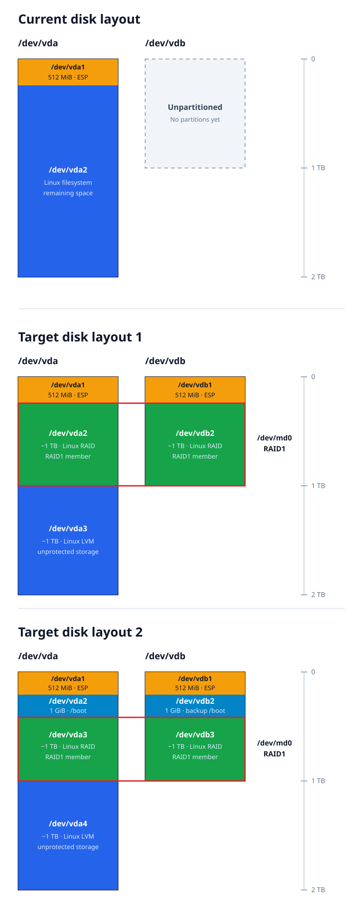

Я хотел бы применить полученные знания на практие, для этого я хотел бы использовать raid и lvm на своем домашнем(рабочем) компьютере. Моя цель - это защититься от отказа SSD диска, чтобы работа не остановилась. Сценарий использования будет таким. У меня 2 SSD диска в зеркале. Если один из дисков отказывает то я могу продолжать работать, а исправлением возникшей проблемы заняться позже, например на выходных, когда на это будет время.

На сегодняшний день у меня только один SSD диск на 2TB. Покупать еще один такого же размера мне кажется не целесообразно(дорого). Поэтому я планирую купить SSD на 1TB и таким образом иметь 1TB в raid1 массиве и еще один 1TB не защищенных raid массивом.

ESP (EFI System Partition) должен быть одтельным разделом на диске, поэтому он должен присутствовать на каждом из дисков отдельно и поэтому нужно отдельно синхронизировать, но это не часто будет происходить. Вопрос можно ли (целесообразно ли) помещать /boot внутрь raid массива. Ниже я привожу 2 варианта разметки диска, хотел бы понять какой вариант лучше. Мы еще не проходили как происходит загрузка ОС, поэтому я могу не понимать всех ограничений связанных с помещением `/boot` внутрь raid массива.

